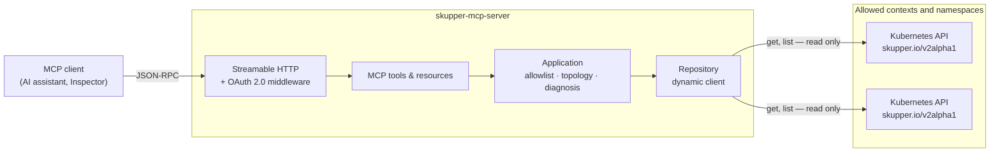

# Skupper MCP Server

> **An independent, community project.** It is not affiliated with, endorsed by,
> sponsored by, or officially supported by Red Hat, Inc. or by the Skupper
> project maintainers. "Skupper" appears here only to describe the software this
> server observes.

A read-only [Model Context Protocol](https://modelcontextprotocol.io) server
that lets an AI client query, understand, and diagnose a
[Skupper v2](https://skupper.io) application network.

It is not a wrapper around the `skupper` or `kubectl` command line. It reads
Skupper v2 custom resources through the Kubernetes API and returns typed JSON:
sites, links, listeners, connectors, a structured topology, and a deterministic
connectivity diagnosis that shows its evidence.

**What it will never do:** create, change, or delete anything; read a `Secret`;
run a command; take a kubeconfig path from a client; measure latency; or claim
to have tested traffic it did not send.

---

## Resumo em português

Servidor MCP somente leitura para observar uma application network do Skupper
v2. Ele expõe seis ferramentas de domínio — `list_sites`, `list_links`,
`list_listeners`, `list_connectors`, `get_topology` e `diagnose_connectivity` —
que leem os recursos customizados do Skupper pela API do Kubernetes e devolvem
JSON tipado.

Não é um invólucro de CLI: nenhuma saída de comando é interpretada. O MVP não
cria, altera nem remove nenhum recurso, e nunca lê Secrets. O diagnóstico é
determinístico e distingue explicitamente **estado declarado**, **estado
observado** e **inferência** — ele nunca afirma ter testado tráfego, medido
latência ou validado TLS ponta a ponta, porque não faz nada disso.

Projeto comunitário e independente, sem relação oficial com a Red Hat ou com os
mantenedores do Skupper.

---

## Architecture



The domain and the application layer know nothing about Kubernetes or MCP, which
is why the topology builder and the diagnosis engine are tested against an
in-memory snapshot with no cluster.

## Tools

| Tool | Arguments | Returns |
|---|---|---|
| `list_sites` | `context?`, `namespace?` | Sites with identity, observed status, generation vs. observed generation, endpoints |
| `list_links` | `context?`, `namespace?`, `site?` | Links with local and remote site, status, cost, endpoints, conditions |
| `list_listeners` | `context?`, `namespace?`, `site?` | Listeners with routing key, host, port, protocol, matched flag |
| `list_connectors` | `context?`, `namespace?`, `site?` | Connectors with routing key, selector or host, port, protocol, selected pod count |
| `get_topology` | `context?`, `namespace?` | Sites as nodes, links as edges, routing-key groups, warnings, observed scope |
| `diagnose_connectivity` | `source*`, `target*`, `routingKey` | Verdict, confidence, per-check evidence, link path, in-band disclaimer |

Omitting `context` reads every allowed context. Omitting `namespace` reads every
namespace allowed in that context — **never** every namespace in the cluster.

The same data is also published as read-only MCP resources, which call the same
application service so the two surfaces cannot disagree:
`skupper://sites`, `skupper://links`, `skupper://listeners`,
`skupper://connectors`, `skupper://topology`.

## Quickstart

For shared or enterprise use, complete the [operator guide](docs/operator-guide.md)
and [deployment evidence record](docs/compliance.md). This repository does not
constitute an organizational compliance approval. Local quickstarts use ambient
operator credentials and are testing profiles.

Host execution requires the Go toolchain pinned in `go.mod` and a kubeconfig
with access to a cluster running Skupper v2. To work without installing Go,
use the [development container](#development).

```bash
git clone https://github.com/darioajr/skupper-mcp
cd skupper-mcp

# Streamable HTTP on 127.0.0.1:8080, reading one namespace.
SKUPPER_MCP_ALLOWED_NAMESPACES=west make run

# Or on stdio, for a desktop MCP client.
SKUPPER_MCP_ALLOWED_NAMESPACES=west make stdio
```

Two namespaces across two clusters:

```bash
SKUPPER_MCP_ALLOWED_CONTEXTS="west-cluster,east-cluster" \
SKUPPER_MCP_ALLOWED_NAMESPACES="west-cluster/west,east-cluster/east" \
go run ./cmd/skupper-mcp-server
```

### Without a cluster

The repository ships sanitized fixtures and a loopback fixture API server, so
you can drive the real binary end to end with nothing installed but Go and Node:

```bash
make inspector-e2e
```

That starts the fixture API server, starts the real server against it, and uses
MCP Inspector to list the tools, call each one, and assert no Secret name
appears in any response.

## Connecting a client

### MCP Inspector

```bash
# Streamable HTTP, against a running server:
npx @modelcontextprotocol/inspector --cli \
  --transport http --server-url http://127.0.0.1:8080/mcp \
  --method tools/list

# stdio, launching the server itself:
make inspector
```

### Claude Code

```bash
claude mcp add --transport http skupper http://127.0.0.1:8080/mcp
```

### A client config file

```json
{
  "mcpServers": {
    "skupper": {
      "command": "/usr/local/bin/skupper-mcp-server",
      "env": {
        "SKUPPER_MCP_TRANSPORT": "stdio",
        "SKUPPER_MCP_ALLOWED_CONTEXTS": "west-cluster,east-cluster",
        "SKUPPER_MCP_ALLOWED_NAMESPACES": "west-cluster/west,east-cluster/east"
      }
    }
  }
}
```

## Example questions and answers

**"Which Skupper sites can you see, and are they healthy?"**

The model calls `list_sites` and gets, per site, a stable id, its context and
namespace, its observed status, and — importantly — whether the status is stale:

```json
{
  "id": "11111111-1111-1111-1111-111111111111",
  "context": "west-cluster",
  "namespace": "west",
  "name": "west",
  "status": "Ready",
  "generation": 3,
  "observedGeneration": 3,
  "generationObserved": true,
  "sitesInNetwork": 2
}
```

**"Draw me the network."**

`get_topology` returns nodes, edges and routing-key groups as JSON. The server
does not return Mermaid or ASCII art; the client decides how to render it. A
site referenced by a link but outside the allowed scope appears as a node with
`"observed": false`, so the edge of the view is visible rather than implied.

**"Traffic to `backend` from west isn't reaching east. Why?"**

`diagnose_connectivity` runs seven checks and shows its work:

```json
{
  "status": "BROKEN",
  "confidence": "HIGH",
  "summary": "Routing key \"backend\" from context west-cluster/namespace west to context east-cluster/namespace east: 1 check(s) failed. At least one required resource is missing or reports an error, so this path cannot be working.",
  "checks": [
    {
      "name": "target-connector",
      "status": "FAIL",
      "evidence": [
        {
          "kind": "ABSENT",
          "statement": "no Connector with routingKey \"backend\" found at context east-cluster/namespace east"
        }
      ],
      "explanation": "No Connector for routing key \"backend\" exists at the target.",
      "recommendation": "Create a Connector with this routing key in the target namespace, selecting the workload that should serve the traffic."
    }
  ],
  "method": {
    "technique": "Static analysis of Skupper v2 custom resource spec and status read through the Kubernetes API. No traffic was sent and no change was made.",
    "notVerified": [
      "end-to-end network reachability",
      "latency or throughput",
      "TLS certificate chain validation",
      "application-level health of the target workload",
      "router-to-router state beyond what the Skupper controller published"
    ]
  }
}
```

Every piece of evidence is labelled `DECLARED` (from a spec), `OBSERVED` (from a
status written by the Skupper controller), `INFERRED` (a conclusion this server
drew), or `ABSENT` (something expected was not found). The `method` block is
part of the payload so a model relaying the answer cannot honestly overstate it.

## Configuration

Environment variables, all prefixed `SKUPPER_MCP_`. An optional YAML file named
by `SKUPPER_MCP_CONFIG_FILE` supplies defaults; the environment wins. The file
may not contain credentials, and the server refuses to start if it does.

| Variable | Default | Meaning |
|---|---|---|
| `TRANSPORT` | `http` | `http` (Streamable HTTP) or `stdio` |
| `ADDR` | `127.0.0.1:8080` | Bind address. A non-loopback bind requires auth |
| `MCP_PATH` | `/mcp` | Path the MCP handler is mounted on |
| `READ_ONLY` | `true` | Must stay true; startup fails otherwise |
| `ALLOW_UNAUTHENTICATED_REMOTE` | `false` | Acknowledges an unauthenticated non-loopback bind. Needed in a Pod, which must bind `0.0.0.0` |
| `MAX_ITEMS` | `500` | Cap per tool call, ceiling 5000 |
| `REQUEST_TIMEOUT` | `10s` | Whole tool/resource invocation and each Kubernetes list call |
| `SESSION_TIMEOUT` | `30m` | Idle MCP session expiry; 0 disables |
| `SHUTDOWN_GRACE` | `15s` | Graceful shutdown budget |
| `IN_CLUSTER` | `false` | Use the pod service account instead of a kubeconfig |
| `ALLOWED_CONTEXTS` | current context | Comma-separated kubeconfig context names |
| `ALLOWED_NAMESPACES` | *(required)* | `ns` or `context/ns`, comma-separated |
| `CURRENT_CONTEXT_ALIAS` | `default` | Logical name for the ambient context |
| `K8S_QPS` / `K8S_BURST` | `20` / `30` | Client-side rate limits |
| `K8S_PAGE_SIZE` | `200` | List chunk size |
| `AUTH_ENABLED` | `false` | Turn on OAuth 2.0 bearer verification |
| `AUTH_ISSUER` | — | OIDC issuer URL; must be https |
| `AUTH_RESOURCE_URL` | — | Public HTTPS MCP endpoint, distinct from its metadata URL |
| `AUTH_RESOURCE_METADATA_URL` | — | Public HTTPS protected-resource metadata URL |
| `AUTH_AUDIENCE` | — | Expected token audience, i.e. this server |
| `AUTH_SCOPE_READ` | `skupper:read` | Scope granting the `viewer` role |
| `AUTH_SCOPE_DIAGNOSE` | `skupper:diagnose` | Scope granting the `diagnostician` role |
| `AUTH_CLOCK_SKEW` | `30s` | Tolerance on token expiry |
| `AUTH_EXCHANGE_URL` | — | Approved HTTPS RFC 8693 token endpoint; required with auth |
| `AUTH_KUBERNETES_AUDIENCE` | — | Delegated user token audience, distinct from the MCP audience |
| `AUTH_EXCHANGE_CLIENT_ID` | — | Confidential delegated-exchange client |
| `AUTH_EXCHANGE_CLIENT_SECRET` | — | Required with auth; injected at runtime, env-only |
| `LIMIT_PER_USER` / `LIMIT_PER_SESSION` | `60` / `30` | Tool/resource invocations per user/session per window |
| `LIMIT_WINDOW` | `1m` | Fixed budget window |
| `LIMIT_BREAKER_THRESHOLD` | `5` | Excess invocations before circuit opens |
| `LIMIT_COOLDOWN` | `1m` | Circuit-open pause |
| `LIMIT_MAX_ENTRIES` | `10000` | Bounded combined user/session limiter state |
| `LIMIT_ALERT_OWNER` | `local-operator` | Owner identifier for circuit alert routing |
| `LOG_LEVEL` / `LOG_FORMAT` | `info` / `json` | Structured logging |

Validation reports every problem at once and says what to do about each:

```
skupper-mcp-server: invalid configuration:
  - SKUPPER_MCP_ALLOWED_NAMESPACES is empty; this server never lists across all
    namespaces, so at least one namespace must be allowed (for example
    "west,east" or "prod/payments")
```

## Deploying

```bash
make image IMAGE=quay.io/darioajr/skupper-mcp-server:dev

# Development: one namespace, debug logging, no auth, reached by port-forward.
kubectl apply -k deploy/kustomize/overlays/dev

# Demonstration: configure delegated OAuth, native user RBAC and the Route first.
kubectl apply -k deploy/kustomize/overlays/demo
```

The demo requires an IdP with RFC 8693 user delegation and Kubernetes configured
for those delegated identities. Replace its placeholders and inject the exchange
client secret through the approved runtime mechanism. Apply
`deploy/kustomize/overlays/demo/watched-rbac` separately only if the system owner
approves those native grants; the example group must be replaced. The server's
ServiceAccount receives no Skupper RoleBinding in this overlay. The demo uses one
replica because budgets are process-local. Its edge TLS and example NetworkPolicy
require deployment-specific review; see the operator guide.

The image is built on UBI Micro — no shell, no package manager, no compiler —
and runs as a non-root user with a read-only root filesystem and all
capabilities dropped. The binary is PID 1, so `SIGTERM` reaches it directly and
its own graceful shutdown runs.

## Publishing a container version

CI builds and checks the image on pull requests, pushes to `main`, and version
tags. After **all** validation jobs succeed, pushing a stable `vMAJOR.MINOR.PATCH`
tag in `darioajr/skupper-mcp` also builds and publishes the same `linux/amd64`
image to both registries, with SBOM and build provenance attestations:

- `quay.io/darioajr/skupper-mcp-server:MAJOR.MINOR.PATCH`
- `ghcr.io/darioajr/skupper-mcp-server:MAJOR.MINOR.PATCH`

Before the first publication:

1. Create the `darioajr/skupper-mcp-server` repository in Quay and grant a Quay
   robot account write access to that repository.
2. In GitHub **Settings → Secrets and variables → Actions**, create repository
   secrets `QUAY_USERNAME` (the complete robot username, such as
   `darioajr+github_actions`) and `QUAY_PASSWORD` (its token).
3. GHCR uses the workflow's automatic `GITHUB_TOKEN` with `packages: write`;
   no personal access token is required. If the GHCR package already exists,
   grant this repository Actions access to it. Set registry/package visibility
   for your consumers, or configure image-pull credentials for private images.

To publish, update `Version` in `internal/mcpserver/server.go` and the changelog,
commit and merge the release changes, then tag that commit. For example, after
setting `Version` to `0.2.0`:

```bash
git switch main
git pull --ff-only
git tag -a v0.2.0 -m "Release v0.2.0"
git push origin v0.2.0
```

The tag must match the server version; prerelease tags are rejected. Publication
uses the numeric image tag (`0.2.0`), without the Git tag's `v` prefix. No `latest`
tag is moved and no GitHub Release is created. PRs and branch builds do not log
in to registries or publish images. Protect version tags with repository rules
and do not move or reuse a published version tag.

The publishing job summary contains both image references and their digest.
Pin that digest in your environment's Kustomize overlay for deployment and
rollback. Publishing to two registries is not atomic: if one push fails, inspect
both registries and rerun the failed workflow for the same commit. Registry
publication does not configure or deploy the OpenShift authentication described
in the [operator guide](docs/operator-guide.md).

## Permission model

Kubernetes side — the whole grant:

```yaml
rules:
  - apiGroups: ["skupper.io"]
    resources: ["sites", "links", "listeners", "connectors"]
    verbs: ["get", "list", "watch"]
```

No `secrets`, no core group, no write verb. Local testing uses a per-namespace
ServiceAccount grant. Authenticated HTTP instead uses an exchanged native user
token, so access is the intersection of the allowlist, MCP role and native RBAC.
The MCP token is never forwarded directly to Kubernetes. An exchange failure or
native access denial has no ambient credential fallback.

MCP side — two roles, mapped from token scopes, `diagnostician` a superset of
`viewer`:

| Role | Scope | May call |
|---|---|---|
| `viewer` | `skupper:read` | the four listings, `get_topology`, all resources |
| `diagnostician` | `skupper:diagnose` | everything above, plus `diagnose_connectivity` |

Authenticated calls require signed JWT access tokens and an IdP exchange policy
that preserves the user's native identity/groups with a distinct Kubernetes
audience. Both read and diagnose scopes are required for HTTP diagnosis. The
[operator guide](docs/operator-guide.md) documents this breaking requirement,
short-lived token/revocation policy and live acceptance checks.

With `AUTH_ENABLED=false` there is no authentication, and configuration
validation refuses to start on a non-loopback address unless
`ALLOW_UNAUTHENTICATED_REMOTE=true` says so deliberately. A Pod has to bind
`0.0.0.0` to receive Service traffic, so the `dev` overlay sets that flag and
relies on the NetworkPolicy to bound who can reach the port. The `demo` overlay
enables real authentication instead.

## Known threats and limitations

- **The server reports state, not reality.** Everything it returns comes from a
  resource spec or a controller-written status. A network can be configured
  perfectly and still be broken by a firewall, a NetworkPolicy, or an
  application fault, and this server cannot see any of those.
- **`diagnose_connectivity` is static analysis.** It sends no traffic, measures
  no latency, and validates no TLS chain. Every response says so in-band.
- **Redaction is a mitigation, not the guarantee.** The guarantee is structural:
  no `Secret` is ever read, and `tlsCredentials` is dropped at decode time. The
  scrubber over free-form controller messages is best-effort; see
  [SECURITY.md](SECURITY.md).
- **Token scopes are trusted as issued.** The server does not re-check group
  membership against a directory.
- **A compromised pod compromises the configured trust boundary.** Local mode
  has its ambient grants; authenticated mode holds an exchange-client credential
  and handles user tokens. Protect both the pod and the IdP delegation policy.
- **Invocation budgets are process-local.** User/session limits and a burst
  circuit cover tools and resources, including invalid calls. Restarts reset
  state; multiple replicas need a shared gateway limiter. Circuit events require
  a configured external alert route.
- **No corporate approval is implied.** Legal, source-owner, privacy, security,
  inventory, log-retention and registry evidence remain deployment obligations.
- **Partial views are normal.** One unreachable cluster degrades to a warning
  rather than failing the call, so always read the `warnings` field.

## Troubleshooting

**`invalid configuration: SKUPPER_MCP_ALLOWED_NAMESPACES is empty`**
By design. This server never lists cluster-wide, so it needs at least one
namespace.

**`kubernetes preflight: context "x": resolving kubeconfig context "x"`**
The named context is not in your kubeconfig. Contexts are validated at startup
rather than on the first tool call.

**A tool returns `context not allowed` or `namespace not allowed`**
Also by design, and reported explicitly rather than as an empty result: a
silently empty listing would let a client map the allowlist by inference. Add
the scope to the allowlist, and add a matching RoleBinding.

**A listing is empty but you expected results**
Check the `scope` field: it names every context and namespace actually read. An
empty `scope` means nothing was read; a populated `scope` with no items means
there is genuinely nothing there.

**A warning says `the sites.skupper.io CRD is not installed`**
Skupper v2 is not installed in that cluster, or the CRDs are a different
version. The rest of the answer is still returned.

**`diagnose_connectivity` says `UNKNOWN` with low confidence**
Something it needed was unobservable — usually an endpoint site outside the
allowlist, or a connector that targets a bare host rather than a pod selector.
The evidence entries name what was missing.

**Results are truncated**
`MAX_ITEMS` was reached. Narrow the query with `context` or `namespace` rather
than raising the cap.

## Development

To develop without Go installed locally, open this repository with the VS Code
Dev Containers extension and select **Reopen in Container**. The
[devcontainer](.devcontainer/devcontainer.json) supplies Go, lint/security tools,
kubectl and Node.js. Podman is required on the host. Setup, terminal-only
usage and toolchain updates are described in [CONTRIBUTING.md](CONTRIBUTING.md#getting-set-up).

```bash
make verify        # gofmt, vet, race tests, lint, govulncheck, manifests
make cover         # coverage by function
make inspector-e2e # drive the real binary with MCP Inspector, no cluster needed
```

See [AGENTS.md](AGENTS.md) for the commands, conventions, and definition of
done, and [docs/adr/](docs/adr/) for the architectural decisions:
[how Skupper is read](docs/adr/0001-skupper-api-access-strategy.md),
[which transport](docs/adr/0002-mcp-transport.md), and
[the original security model](docs/adr/0003-security-model.md), and
[native authorization and invocation controls](docs/adr/0004-native-user-access-and-invocation-controls.md).

## Roadmap

Deliberately out of scope for the MVP, tracked in [ROADMAP.md](ROADMAP.md): any
write operation, AccessToken handling, self-remediation, Ansible, LLM-specific
integrations, AI log analysis, traffic or latency metrics, Skupper v1 support,
and a web dashboard.

## License

[Apache-2.0](LICENSE). See [NOTICE](NOTICE).
